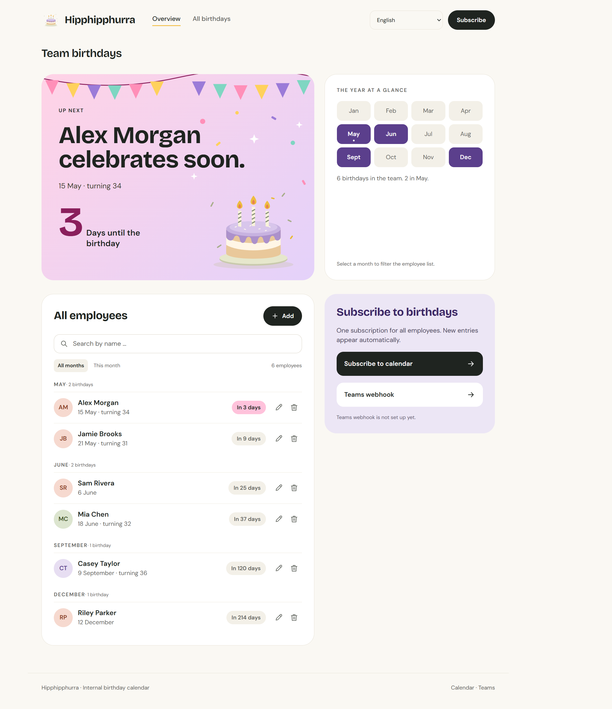

# Hipphipphurra

Manage team birthdays, subscribe to a calendar feed, and receive reminders through
a Teams webhook. Built for internal use, without user accounts. Available in English
and German, with automatic browser language detection.



## Docker Compose setup

Download [compose.yaml](compose.yaml) and [.env.example](.env.example).
Save the example as `.env` and set the image address:

```dotenv
IMAGE=ghcr.io/your-account/your-repository:latest
BASE_URL=http://localhost:3000
TEAMS_WEBHOOK_URL=
TEAMS_LANGUAGE=de
```

Use lowercase account and repository names. `latest` follows the most recently
published stable release. `TEAMS_WEBHOOK_URL` is optional.

On Linux, prepare the data directory before the first start:

```sh
mkdir -p data
sudo chown 1000:1000 data
```

Start the application:

```sh
docker compose up -d
```

Open **http://localhost:3000**. Data is stored persistently in `./data`.
For access from your internal network, set `BIND_ADDRESS=0.0.0.0` and set
`BASE_URL` to the reachable server address. The published image supports Linux/amd64.

## Secure operation

Anyone who can access the application can read, edit, and delete all entries.
Restrict access to the intended users through network rules or an authentication
proxy. Use a reverse proxy for HTTPS.

Keep the Teams webhook URL secret in `.env` or your deployment configuration.
If it is exposed, replace the URL in the Teams workflow and update the
configuration. Deleting it from a file does not remove it from published Git commits.

Do not upload real employee data, the data directory, or backups to the repository.
See [CONTRIBUTING.md](CONTRIBUTING.md#updates-and-backups) for updates and backups,
and [SECURITY.md](SECURITY.md) for supported versions and vulnerability reporting.

## Licenses

- Project code and graphics: [MIT](LICENSE).
- Bricolage Grotesque and DM Sans: SIL Open Font License 1.1.
  Sources and license texts: [THIRD_PARTY_NOTICES.md](THIRD_PARTY_NOTICES.md).

Development and project maintenance: [CONTRIBUTING.md](CONTRIBUTING.md).
